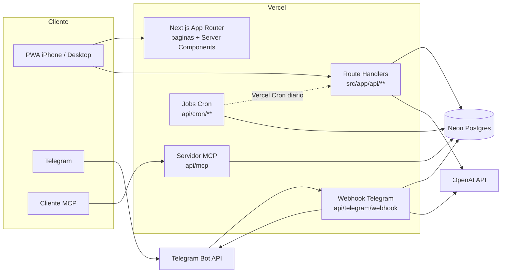

# Containers

Não é monorepo: um único projeto Next.js na raiz do repositório, implantado na Vercel, mais o banco Neon. As "unidades" abaixo são pontos de entrada do mesmo deploy.

## Unidades

| Unidade | Local | Responsabilidade | Comunicação |
|---|---|---|---|
| App web / PWA | `src/app/(app)/{hoje,lancamentos,planejar,cartoes,mais}` | UI mobile-first; Server Components leem via use-cases | HTTP para a API; sessão por cookie |
| API | `src/app/api/**/route.ts` | Adaptadores HTTP finos: validam com Zod, chamam use-cases | JSON sobre HTTPS |
| Webhook Telegram | `src/app/api/telegram/webhook` | Recebe updates, valida secret token e `chatId`, chama tools | Telegram para Vercel; resposta via Bot API |
| Servidor MCP | `src/app/api/mcp` | Expõe as mesmas tools (ADR-025), read-only por padrão | HTTP, autenticado por `MCP_TOKEN` |
| Jobs Cron | `src/app/api/cron/**` | Materializar recorrências, agentes (Vigia, Resumo, Fechamento), reconciliação | GET agendado pela Vercel, autenticado por `CRON_SECRET`; idempotentes (ADR-030) |
| Neon Postgres | externo | Persistência; fonte de verdade é o ledger (ADR-019) | Prisma 7 sobre `DATABASE_URL` |

## Estado atual (1.x)

- Um único container lógico: app Next.js 16 com Route Handlers em `src/app/api/{accounts,analytics,auth,categories,credit-card-purchases,credit-cards,dashboards,goals,recurring-rules,settings,transactions,wishlist}`.
- Vários Route Handlers acessam o Prisma direto (ex.: `src/app/api/transactions/route.ts` importa `prisma` de `@/server/db`); parte da lógica está em `src/server/modules/finance/application/**`.
- Não há `vercel.json`, nem rotas de cron, webhook ou MCP.
