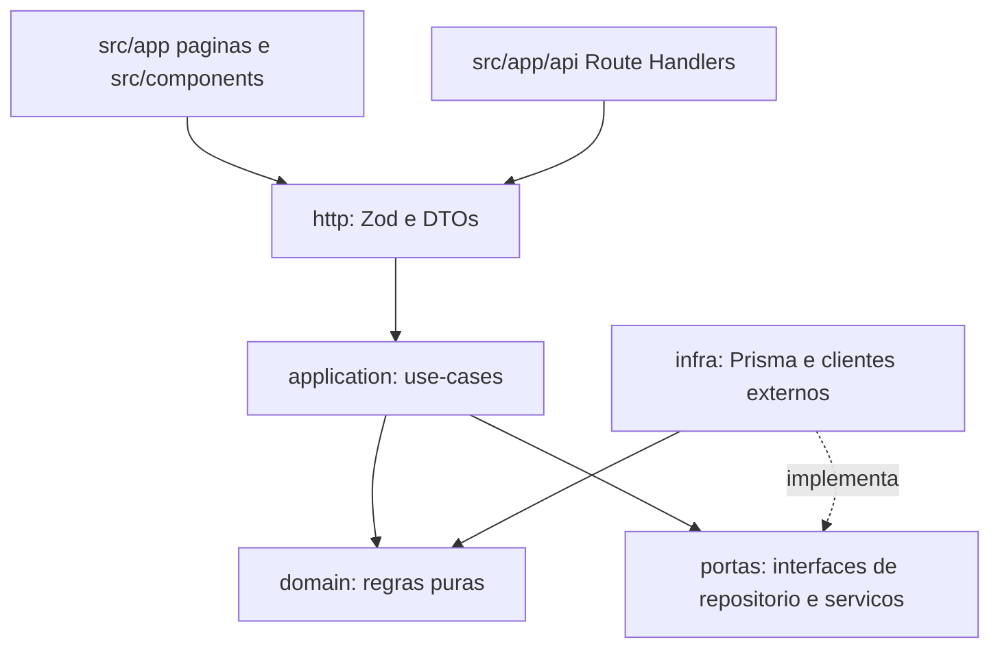

# Dependências

## Direção entre camadas

## Regras

| Camada | Pode importar | Não pode importar |
|---|---|---|
| `domain/` | outros `domain/` do mesmo módulo, `src/lib` puro | Prisma, Next.js, React, `infra/`, `application/`, qualquer I/O |
| `application/` | `domain/`, portas (interfaces) declaradas no módulo, `domain/` de outros módulos via contrato público | Prisma Client, `next/*`, `http/`, `src/components` |
| `infra/` | implementa as portas; usa Prisma, `fetch`, SDKs; pode usar `domain/` | `application/` (evita ciclo), `http/`, UI |
| `http/` (schemas, DTOs) | `application/`, `domain/` (tipos), Zod | `infra/` direto, React |
| `src/app/**` (páginas e Route Handlers) | apenas `application/` e `http/` (mais `auth` para sessão) | `domain/` com lógica própria, `infra/`, Prisma direto |
| `src/components/**` | `src/lib`, tipos de DTO, outros componentes | qualquer coisa de `src/server/**` |

## Regras transversais

- **Camada única de tools (ADR-025):** UI, bot Telegram, MCP e agentes chamam os mesmos use-cases; `tools` apenas registra schemas Zod e delega.
- **Entre módulos:** dependência só via API pública do módulo (`application/index.ts`); sem importar arquivos internos de outro módulo. Ciclos entre módulos são proibidos.
- **Fronteira de dinheiro e datas:** centavos inteiros (`src/lib/money.ts`) e datas de calendário ao meio-dia UTC (ADR-002).
- **Estilo:** nenhuma cor, raio ou sombra literal em componentes; apenas tokens `--fc-*` (ADR-018).
- **Isolamento de dados:** toda query filtra por `userId`.
- **Verificação:** a direção é conferida em revisão pelo `qa-revisor`; regra de lint (`no-restricted-imports`) é recomendada como automação futura.

## Estado atual (1.x)

- As regras acima são violadas: Route Handlers importam `prisma` direto (`src/app/api/transactions/route.ts`) e a lógica fica espalhada entre handlers e `src/server/modules/finance/application/**`.
- `src/server/modules/finance/domain/` e `infra/` existem vazios; não há portas nem repositórios.
- Não há regra de lint de fronteira.
