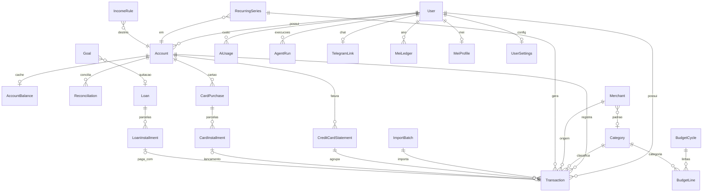

# Modelo de dados do 2.0 (dicionário)

Schema escrito do zero (ADR-016), 29 modelos e 26 enums. O código (`prisma/schema.prisma`) manda quando divergir deste documento; o teste `prisma/schema.contract.test.ts` protege as decisões-chave (uniques de `Transaction`, dinheiro `Int`, índices por `userId`, valores dos enums).

## Convenções

- Tabelas `snake_case` plural (`@@map`), colunas `snake_case` (`@map`), ids `String` cuid, `createdAt`/`updatedAt` nos modelos mutáveis.
- Dinheiro em centavos `Int` (ADR-002). `Transaction.amount` é **assinado** (positivo entra na conta, negativo sai) e nunca zero.
- Únicas colunas `Decimal`: `Loan.monthlyRate` (fração mensal, `0.019900` = 1,99% a.m.), `Loan.lateFeePct` e `Loan.lateInterestMonthlyPct`. A camada de domínio converte com `.toNumber()` na borda do repositório.
- Datas de calendário: `DateTime` ao meio-dia UTC (sem `@db.Date`); instantes (`createdAt`, `startedAt`) em UTC.
- Cores e ícones por chave de token (`colorKey` como `cat-3`), nunca hex.
- Todo modelo financeiro tem `userId` (FK `Cascade`) e índice começando por `userId`. Exceções: `User` (raiz), `LoginAttempt` (anterior à identificação) e os filhos `LoanInstallment`, `CardInstallment` e `BudgetLine`, escopados pela FK do pai.
- Saldo da conta = soma de `Transaction.amount` (ADR-019); `AccountBalance` é cache recalculável.
- Sem seed no schema: usuário dono e categorias padrão nascem em F0-06 e F1-07.

## Diagrama ER

## Enums

| Enum                | Valores                                                                            |
| ------------------- | ---------------------------------------------------------------------------------- |
| `AccountType`       | CHECKING, SAVINGS, WALLET, INVESTMENT, CREDIT_CARD, BUSINESS                       |
| `CategoryType`      | INCOME, EXPENSE                                                                    |
| `Nature`            | MUST, NEED, WANT                                                                   |
| `TxnKind`           | EXPENSE, INCOME, TRANSFER, CARD_PAYMENT, FEE, INTEREST, ADJUSTMENT                 |
| `TxnStatus`         | PLANNED, PENDING, CLEARED, RECONCILED                                              |
| `ReviewState`       | NEEDS_REVIEW, REVIEWED                                                             |
| `TxnSource`         | MANUAL, QUICKADD, IMPORT, BOT, RECURRING, OPEN_FINANCE                             |
| `CategorySource`    | USER, RULE, MERCHANT, LLM, PARSER, IMPORT                                          |
| `SeriesKind`        | BILL, SUBSCRIPTION, INCOME, TRANSFER, LOAN_INSTALLMENT, TAX                        |
| `LoanKind`          | CONSIGNADO, PERSONAL, OVERDRAFT, CARD_REVOLVING, CARD_REFINANCE, PIX_CREDIT        |
| `LoanSystem`        | PRICE                                                                              |
| `LoanStatus`        | ACTIVE, PAID_OFF, DEFAULTED                                                        |
| `InstallmentStatus` | PENDING, PAID, SKIPPED                                                             |
| `StatementStatus`   | OPEN, CLOSED, PAID, OVERDUE                                                        |
| `BudgetBucket`      | FIXED, NON_MONTHLY, FLEX                                                           |
| `RuleStage`         | PRE, DEFAULT, POST                                                                 |
| `RuleOrigin`        | USER, LEARNED                                                                      |
| `ImportKind`        | OFX, CSV, PDF_ITAU_EXTRATO, PDF_ITAU_FATURA, PDF_NUBANK_EXTRATO, PDF_NUBANK_FATURA |
| `ImportStatus`      | PENDING, PROCESSED, FAILED, UNDONE                                                 |
| `GoalKind`          | RESERVE, PRIORITY, WISH, DEBT_PAYOFF                                               |
| `GoalStatus`        | ACTIVE, DONE, ARCHIVED                                                             |
| `ReconStatus`       | MATCHED, ADJUSTED, UNDONE                                                          |
| `CycleMode`         | CALENDAR_MONTH, INCOME_CYCLE                                                       |
| `BusinessDayRule`   | NONE, NEXT_BUSINESS_DAY, PREVIOUS_BUSINESS_DAY                                     |
| `AdditionalBasis`   | PREVIOUS_MONTH, SAME_MONTH                                                         |
| `AgentRunStatus`    | RUNNING, OK, FAILED                                                                |

## Modelos

### Auth e configurações

| Modelo (tabela)                   | Resumo                                                                                                                                                                           | Únicos e índices                             |
| --------------------------------- | -------------------------------------------------------------------------------------------------------------------------------------------------------------------------------- | -------------------------------------------- |
| `User` (`users`)                  | Dono do sistema: `email`, `name?`, `password` (hash bcrypt). Sem `image`.                                                                                                        | `email` único                                |
| `Session` (`sessions`)            | Sessão do cookie: `tokenHash` (SHA-256 hex do token bruto do cookie), `expiresAt`, `lastSeenAt`, `userAgent?`.                                                                   | `tokenHash` único; `[userId]`, `[expiresAt]` |
| `LoginAttempt` (`login_attempts`) | Tentativas de login para rate limit persistente: `key` (hash de IP + email), `success`. Sem `userId`.                                                                            | `[key, createdAt]`                           |
| `UserSettings` (`user_settings`)  | 1:1 com o usuário: `timezone` (`America/Sao_Paulo`), `cycleMode` (`INCOME_CYCLE`), `cushionCents`, tetos de IA em micro-USD (mensal 1.000.000 e total 5.000.000), `privacyMode`. | `userId` único                               |

### Contas e saldos

| Modelo (tabela)                       | Resumo                                                                                                                                                                                                                                              | Únicos e índices                                                                         |
| ------------------------------------- | --------------------------------------------------------------------------------------------------------------------------------------------------------------------------------------------------------------------------------------------------- | ---------------------------------------------------------------------------------------- |
| `Account` (`accounts`)                | Conta ou cartão: `type`, `issuerKey?`/`networkKey?` (registry de marcas), `colorKey?`, `icon?`, `overdraftLimit` (>= 0), `creditLimit?`, `closingDay?`/`dueDay?` (1-31), `isArchived`, `sortOrder`. Conta com lançamentos é arquivada, não apagada. | `[userId, name]` único; `[userId, isArchived]`                                           |
| `AccountBalance` (`account_balances`) | Cache 1:1 (PK = `accountId`): `balanceCleared`, `balancePending`, `balancePlanned`, `lastEntryDate?`, `version`. Recalculável do ledger (ADR-019).                                                                                                  | `[userId]`                                                                               |
| `Reconciliation` (`reconciliations`)  | Conciliação com o banco: `asOfDate`, `bankBalance`, `ledgerBalance`, `difference`, `status`, `reconciledCount`, `reconciledIds` (Json, para desfazer), `adjustmentTransactionId?` (lançamento ADJUSTMENT), `note?`.                                 | `adjustmentTransactionId` único; `[userId, asOfDate desc]`, `[accountId, asOfDate desc]` |

### Catálogos

| Modelo (tabela)           | Resumo                                                                                                                                                           | Únicos e índices                                  |
| ------------------------- | ---------------------------------------------------------------------------------------------------------------------------------------------------------------- | ------------------------------------------------- |
| `Category` (`categories`) | `key` (slug estável), `name`, `type`, `nature?` (MUST/NEED/WANT), `icon?`, `colorKey?`, `parentId?` (auto-relação, `SetNull`), `isSystem`, `isArchived`.         | `[userId, key]` único; `[userId, parentId]`       |
| `Merchant` (`merchants`)  | Estabelecimento normalizado: `normalizedKey`, `aliases[]`, `defaultCategoryId?`, `recentCategoryIds[]` (últimas 3), `nature?`, `defaultAccountId?`, `brandKey?`. | `[userId, normalizedKey]` único; GIN em `aliases` |

### Ledger

| Modelo (tabela)                | Resumo                                                                                                                                                                                                                                                                                                                                                                                                                                                                                                                                 | Únicos e índices                                                                                                                                                                                                                                                                                                                                   |
| ------------------------------ | -------------------------------------------------------------------------------------------------------------------------------------------------------------------------------------------------------------------------------------------------------------------------------------------------------------------------------------------------------------------------------------------------------------------------------------------------------------------------------------------------------------------------------------- | -------------------------------------------------------------------------------------------------------------------------------------------------------------------------------------------------------------------------------------------------------------------------------------------------------------------------------------------------- |
| `Transaction` (`transactions`) | Lançamento. `kind`, `status` (padrão CLEARED), `review` (padrão REVIEWED), `source` (padrão MANUAL), `amount` (assinado, `<> 0`), `date` (meio-dia UTC), `postedDate?`, `description`, `rawDescription?`, `tags[]`, `transferId?` (par), `refundOfId?` (estorno, auto-relação), `seriesId?` + `occurrenceKey?` (previstos), `statementId?` + `statementKey?` (AAAA-MM), `importBatchId?` + `importHash?`, `categorySource?`, `aiConfidence?` (0-100), `userLocked` (Json), `excludeFromBudget`, `originalCurrency?`/`originalAmount?`. | Únicos `[userId, importHash]`, `[userId, occurrenceKey]`, `[transferId, accountId]`; índices por `[userId, date desc]`, `[accountId, date desc]`, `[accountId, status]`, `[userId, status, date]`, `[userId, review]`, `[categoryId, date]`, `[merchantId]`, `[statementId]`, `[seriesId, date]`, `[transferId]`, `[importBatchId]`, GIN em `tags` |

### Cartões

| Modelo (tabela)                                        | Resumo                                                                                                                                                                              | Únicos e índices                                                                    |
| ------------------------------------------------------ | ----------------------------------------------------------------------------------------------------------------------------------------------------------------------------------- | ----------------------------------------------------------------------------------- |
| `CreditCardStatement` (`credit_card_statements`)       | Fatura: `periodStart`, `periodEnd`, `closingDate`, `dueDate`, `statementKey` (AAAA-MM do vencimento), `totalAmount`, `paidAmount`, `status`.                                        | `[accountId, periodStart]`, `[accountId, statementKey]` únicos; `[userId, dueDate]` |
| `CardPurchase` (`card_purchases`)                      | Compra no cartão: `description`, `purchaseDate`, `totalAmount`, `installmentCount`, categoria/merchant opcionais.                                                                   | `[userId, purchaseDate desc]`, `[accountId]`                                        |
| `CardInstallment` (`card_installments`)                | Parcela, ligada 1:1 ao lançamento (`ledgerTransactionId` único, `Cascade`): `installmentNumber`, `originalAmount`, `originalDate`, `advanceId?`. Sem `userId` (escopo pela compra). | `[purchaseId, installmentNumber]`, `ledgerTransactionId` únicos; `[advanceId]`      |
| `CardInstallmentAdvance` (`card_installment_advances`) | Antecipação de parcelas: `advancedAt`, `totalOriginalAmount`, `totalPaidAmount`, `totalDiscountAmount`. Sem vínculo com wishlist.                                                   | `[userId, advancedAt desc]`, `[purchaseId]`                                         |

### Séries, renda e MEI

| Modelo (tabela)                        | Resumo                                                                                                                                                                                                                                                                      | Únicos e índices       |
| -------------------------------------- | --------------------------------------------------------------------------------------------------------------------------------------------------------------------------------------------------------------------------------------------------------------------------- | ---------------------- |
| `RecurringSeries` (`recurring_series`) | Série RRULE (RFC 5545): `kind`, `name`, `accountId`, `toAccountId?`, `amount` (assinado, esperado), `amountTolerancePct` (10), `dayTolerance` (3), `rrule`, `dtstart`, `until?`, `autoConfirm`, `isActive`, `materializedUntil?`, `incomeRuleId?`, `loanId?`.               | `[userId, isActive]`   |
| `IncomeRule` (`income_rules`)          | Regra de renda base + por dia presencial: `baseCents`, `perDayCents`, `weekdays[]` (0=domingo), `payDay` (1-31), `paymentAdjust`, `additionalBasis`, `destinationAccountId`, `extraDaysOff[]` (ISO), `attendanceOverrides` (Json data -> boolean), `startDate`, `endDate?`. | `[userId, isActive]`   |
| `MeiProfile` (`mei_profiles`)          | 1:1: `openedAt?`, `annualCeilingCents` (8.100.000), `dasAmountCents`, `dasDueDay` (20), `dasAccountId?`, `businessAccountId?`. Sem CNPJ.                                                                                                                                    | `userId` único         |
| `MeiLedger` (`mei_ledgers`)            | Receita acumulada no ano: `accumulatedCents`, `proportionalCeilingCents`, `byMonth` (Json, 12 inteiros), `lastRecomputedAt`.                                                                                                                                                | `[userId, year]` único |

### Dívidas

| Modelo (tabela)                         | Resumo                                                                                                                                                                                                                                              | Únicos e índices                      |
| --------------------------------------- | --------------------------------------------------------------------------------------------------------------------------------------------------------------------------------------------------------------------------------------------------- | ------------------------------------- |
| `Loan` (`loans`)                        | Dívida: `kind`, `name`, `lenderName?`, `accountId?`, `principalCents`, `monthlyRate` (Decimal 9,6), `installmentCount?`, `installmentAmountCents?`, `system` (PRICE), `outstandingCents` (cache), `lateFeePct`, `lateInterestMonthlyPct`, `status`. | `[userId, status]`                    |
| `LoanInstallment` (`loan_installments`) | Parcela: `number`, `dueDate`, `principalCents`, `interestCents`, `amountCents`, `status`, `paidAt?`, `paidAmountCents?`, `lateChargesCents`, `transactionId?` (único). Sem `userId` (escopo pelo `Loan`).                                           | `[loanId, number]` único; `[dueDate]` |

### Orçamento, regras, importação e metas

| Modelo (tabela)                  | Resumo                                                                                                                                                                                                                                                            | Únicos e índices             |
| -------------------------------- | ----------------------------------------------------------------------------------------------------------------------------------------------------------------------------------------------------------------------------------------------------------------- | ---------------------------- |
| `BudgetCycle` (`budget_cycles`)  | Ciclo: `startDate`, `endDate`, `flexAmount`, `cushion`, `expectedIncome?`.                                                                                                                                                                                        | `[userId, startDate]` único  |
| `BudgetLine` (`budget_lines`)    | Linha do ciclo: `bucket` (FIXED/NON_MONTHLY/FLEX), `categoryId?`, `label`, `plannedCents`. Sem `userId` (escopo pelo ciclo).                                                                                                                                      | `[cycleId]`                  |
| `Rule` (`rules`)                 | Regra de categorização: `stage`, `priority`, `conditions`/`actions` (Json), `origin`, `hits`, `lastHitAt?`, `isActive`.                                                                                                                                           | `[userId, stage, priority]`  |
| `ImportBatch` (`import_batches`) | Lote de importação: `kind`, `accountId?`, `fileSha256`, `fileLabel?` (rótulo genérico, nunca o nome real), período, contagens (`totalRows`, `newCount`, `duplicateCount`, `matchedCount`, `errorCount`), `status`, `errorLog?`. O arquivo bruto não é armazenado. | `[userId, fileSha256]` único |
| `Goal` (`goals`)                 | Meta: `kind`, `name`, `targetCents`, `currentCents`, `targetDate?`, `priority`, `accountId?`, `loanId?`, `categoryId?`, `status`. Substitui `Goal` e `WishlistItem` do 1.x.                                                                                       | `[userId, status]`           |

### IA, agentes e Telegram

| Modelo (tabela)                   | Resumo                                                                                                                                      | Únicos e índices                  |
| --------------------------------- | ------------------------------------------------------------------------------------------------------------------------------------------- | --------------------------------- |
| `Memory` (`memories`)             | Preferências e fatos do próprio usuário: `key`, `value` (Json), `scope`.                                                                    | `[userId, key]` único             |
| `AgentRun` (`agent_runs`)         | Execução de agente: `agent`, `status`, `startedAt`, `finishedAt?`, `summary?`, `input?`/`output?` (Json), `costMicroUsd`.                   | `[userId, agent, startedAt desc]` |
| `AiUsage` (`ai_usages`)           | Custo por chamada de IA: `model`, `purpose`, `inputTokens`, `outputTokens`, `costMicroUsd`, `agentRunId?`. Base do teto de US$ 5 (ADR-026). | `[userId, createdAt]`             |
| `TelegramLink` (`telegram_links`) | Chat permitido (ADR-027): `chatId`, `username?`, `isActive`, `linkedAt`.                                                                    | `userId` único; `chatId` único    |

## CHECK constraints (SQL manual na migration)

| Constraint                               | Regra                                               |
| ---------------------------------------- | --------------------------------------------------- |
| `transactions_amount_nonzero`            | `amount <> 0`                                       |
| `transactions_pair_requires_transfer_id` | `kind` TRANSFER ou CARD_PAYMENT exige `transfer_id` |
| `accounts_overdraft_nonneg`              | `overdraft_limit >= 0`                              |
| `accounts_days_range`                    | `closing_day` e `due_day` nulos ou entre 1 e 31     |
| `income_rules_pay_day_range`             | `pay_day` entre 1 e 31                              |

## Invariantes globais

1. Saldo da conta = soma de `Transaction.amount`: `cleared` (CLEARED + RECONCILED), `pending` e `planned` somados à parte; `AccountBalance` é cache atualizado na mesma transação de banco (ADR-019).
2. Nenhum valor monetário em ponto flutuante.
3. Toda leitura e escrita filtra por `userId`.
4. Transferência e pagamento de fatura são pares com o mesmo `transferId`, uma perna por conta (`@@unique([transferId, accountId])`).
5. Reimportar o mesmo arquivo não cria lançamentos novos (`importHash` único por usuário); previstos de série não duplicam (`occurrenceKey` único por usuário).
6. Dia 29/30/31 em série cai no último dia do mês (regra de domínio, não de schema).
7. `RECONCILED` é imutável sem desfazer a reconciliação (regra de domínio; `Reconciliation.reconciledIds` guarda os ids travados).

## Extensões em relação à especificação (§6)

`LoanKind.CARD_REVOLVING`, `Transaction.refundOfId`, `Transaction.occurrenceKey`, `UserSettings`, `MeiProfile`, `LoginAttempt` e `Session.tokenHash`. Justificativas na task FC2-F0-02.

## Legado

O schema 1.x (21 models) foi removido; o dicionário antigo segue em [`data-dictionary.md`](data-dictionary.md) apenas como referência histórica. O 1.x está no histórico do Git (commit `5cfb2c9`, tag `fc-1.x-final`).
