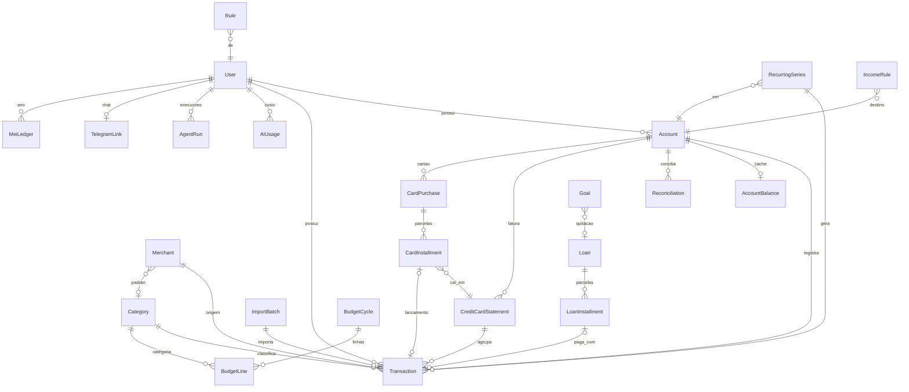

# Modelo de dados do 2.0

Schema escrito do zero (ADR-016). Este documento é a intenção; o código (`prisma/schema.prisma`) manda quando divergir, e a task FC2-F0-02 deve atualizar este doc. Convenções: ids `String` (cuid), valores em centavos `Int`, datas de calendário ao meio-dia UTC, `createdAt`/`updatedAt` em todas as tabelas, `userId` em toda tabela financeira.

## Diagrama ER

## Enums

| Enum | Valores |
|---|---|
| `AccountType` | CHECKING, SAVINGS, WALLET, INVESTMENT, CREDIT_CARD, BUSINESS |
| `TransactionKind` | EXPENSE, INCOME, TRANSFER, CARD_PAYMENT, FEE, INTEREST, ADJUSTMENT |
| `TransactionStatus` | PLANNED, PENDING, CLEARED, RECONCILED |
| `ReviewStatus` | NEEDS_REVIEW, REVIEWED |
| `TransactionSource` | MANUAL, QUICKADD, IMPORT, BOT, RECURRING, OPEN_FINANCE |
| `CategorySource` | USER, RULE, MERCHANT, LLM, DEFAULT |
| `Nature` | MUST, NEED, WANT |
| `RecurringKind` | BILL, SUBSCRIPTION, INCOME, TRANSFER, LOAN_INSTALLMENT, TAX |
| `LoanKind` | CONSIGNADO, PERSONAL, OVERDRAFT, CARD_REFINANCE, PIX_CREDIT |
| `AmortizationSystem` | PRICE |
| `StatementStatus` | OPEN, CLOSED, PAID (mantém a lógica do 1.x) |
| `BudgetBucket` | FIXED, NON_MONTHLY, FLEX |
| `RuleOrigin` | USER, LEARNED |
| `ImportKind` | OFX, CSV, PDF_ITAU_EXTRATO, PDF_ITAU_FATURA, PDF_NUBANK_EXTRATO, PDF_NUBANK_FATURA |
| `ImportStatus` | PENDING, PARSED, REVIEWING, COMPLETED, FAILED |
| `GoalKind` | RESERVE, PRIORITY, WISH, DEBT_PAYOFF |

`CategorySource` e `ImportStatus` são propostas deste documento (a spec cita `categorySource` e contagens/status sem enumerar valores); confirmar na F0-02.

## Entidades

### User e Session
Mantidos do 1.x (`User`, `Session`; auth em `src/server/auth`). Single-user, mas toda tabela referencia `userId`.

### Account
| Campo | Tipo | Notas |
|---|---|---|
| id, userId | | |
| name | String | |
| type | AccountType | |
| issuerKey, networkKey | String? | chaves do registry de marcas (`src/lib/brands`) |
| overdraftLimit | Int | cheque especial, centavos, default 0 |
| creditLimit | Int? | só CREDIT_CARD |
| closingDay, dueDay | Int? | 1 a 31, só CREDIT_CARD |
| openingBalance | Int | saldo inicial do ledger |
| isArchived | Boolean | |

Índice: `(userId, isArchived)`. Único: `(userId, name)`. Invariante: `closingDay`, `dueDay` e `creditLimit` só existem para CREDIT_CARD; saldo negativo em conta corrente é cenário normal até `overdraftLimit`.

### AccountBalance (cache derivado)
`accountId` (único), `cleared`, `pending`, `planned` (centavos), `computedAt`. Pode ser apagado e recomputado do ledger sem perda (ADR-019). Nenhuma regra de negócio lê `AccountBalance` como verdade quando houver divergência na reconciliação.

### Reconciliation
`accountId`, `statementDate`, `bankBalance`, `ledgerBalance`, `difference`, `status`. Índice: `(accountId, statementDate)`. Invariante: marca como RECONCILED os lançamentos CLEARED até a data quando `difference = 0`.

### Category
Do 1.x, com `nature` (Nature, opcional) e `parentId` opcional. Único: `(userId, name)`.

### Merchant
`userId`, `name`, `aliases` (String[]), `defaultCategoryId`, `lastCategoryIds` (até 3), `nature`. Único: `(userId, name)`. Índice GIN opcional em `aliases` quando houver busca por alias.

### Transaction
| Campo | Tipo | Notas |
|---|---|---|
| id, userId, accountId | | |
| kind | TransactionKind | |
| status | TransactionStatus | |
| review | ReviewStatus | default NEEDS_REVIEW para IMPORT/BOT sem certeza |
| source | TransactionSource | |
| amount | Int | centavos, sempre positivo; sinal vem de `kind` e direção |
| date | DateTime | meio-dia UTC |
| description, rawDescription | String | `rawDescription` preserva o texto original do banco |
| categoryId | String? | |
| categorySource | CategorySource? | |
| aiConfidence | Float? | 0 a 1 |
| merchantId | String? | |
| importHash | String? | único por usuário |
| importBatchId | String? | |
| seriesId | String? | série RRULE de origem |
| statementKey | String? | mês de vencimento da fatura (ADR-008) |
| transferGroupId | String? | liga o par de transferência (ADR-004) |
| userLocked | Json | campos editados pelo usuário, que regras/IA não sobrescrevem |
| excludeFromBudget | Boolean | |
| tags | String[] | `#tag` do quick-add |

Únicos: `(userId, importHash)` parcial onde `importHash` não é nulo; `(seriesId, date)` parcial para idempotência do cron. Índices: `(userId, date)`, `(accountId, date)`, `(userId, status, date)`, `(userId, review)`, `(userId, statementKey)`.

Invariantes: transferência são dois lançamentos com o mesmo `transferGroupId` e valores iguais, criados e removidos atomicamente; PLANNED nunca entra no saldo CLEARED; `RECONCILED` é imutável sem desfazer a reconciliação; `userLocked` vence regra e IA.

### RecurringSeries
`userId`, `kind` (RecurringKind), `name`, `amount`, `accountId`, `categoryId?`, `rrule` (RFC 5545), `startDate`, `endDate?`, `toleranceDays`, `toleranceAmountPct`, `autoConfirm`, `materializedUntil`, `isActive`. Índice: `(userId, isActive)`. Invariante: ocorrências PLANNED existem até hoje + 90 dias; regenerar não duplica (único `(seriesId, date)`); dia 29/30/31 cai no último dia do mês (corrige bug do 1.x).

### IncomeRule
`userId`, `name`, `base`, `perDayExtra`, `weekdays` (Int[] 0 a 6), `paymentDay`, `destinationAccountId`, `isActive`. Invariante: `rendaPrevista = base + perDayExtra x diasPresenciais` (ADR-029).

### MeiLedger
`userId`, `year`, `accumulatedRevenue`, `annualCap`, `dasPaidMonths` (Int[]). Único: `(userId, year)`. Acumulado vs teto proporcional ao mês de abertura.

### Loan e LoanInstallment
`Loan`: `userId`, `kind`, `name`, `principal`, `monthlyRate` (Decimal), `installments`, `remainingBalance`, `system` (PRICE), `accountId` (débito), `startDate`, `status`. `LoanInstallment`: `loanId`, `number`, `dueDate`, `amount`, `interest`, `amortization`, `status` (PENDING, PAID, OVERDUE), `transactionId?`. Único: `(loanId, number)`. Invariante: `Σ amortization = principal`; parcela em atraso entra no caixa como pendente (§5.1).

### CreditCardStatement, CardPurchase, CardInstallment
Do 1.x, adaptados: fatura identificada por `(accountId, statementKey)` (único), com `closingDate`, `dueDate`, `status`, `paidTransactionId?`. `CardPurchase` guarda total e nº de parcelas; `CardInstallment` guarda número, valor e fatura de destino. Invariante: soma das parcelas = total da compra (resto na última parcela).

### BudgetCycle e BudgetLine
`BudgetCycle`: `userId`, `startDate`, `endDate`, `kind` (CALENDAR | INCOME_CYCLE), `flexAmount`, `cushion`. Único: `(userId, startDate)`. `BudgetLine`: `cycleId`, `bucket`, `categoryId?`, `plannedAmount`. Invariante: gasto Flex = transações de cartão ou débito do ciclo com `excludeFromBudget = false` e fora das séries fixas.

### Rule
`userId`, `name`, `conditions Json`, `actions Json`, `stage`, `priority`, `origin` (RuleOrigin), `hits`, `isActive`. Índice: `(userId, stage, priority)`. Regras USER vencem LEARNED.

### ImportBatch
`userId`, `kind`, `accountId?`, `fileLabel` (rótulo genérico, nunca o nome do arquivo real), `status`, `totalRows`, `createdCount`, `duplicateCount`, `reviewCount`, `createdAt`. Índice: `(userId, createdAt)`. O arquivo bruto não é armazenado no banco nem no Git.

### Goal
`userId`, `kind` (GoalKind), `name`, `targetAmount`, `currentAmount`, `targetDate?`, `loanId?` (DEBT_PAYOFF), `priority`. Substitui `Goal` e `WishlistItem` do 1.x.

### Memory, AgentRun, AiUsage, TelegramLink
- `Memory`: `userId`, `key`, `value`, `updatedAt`; único `(userId, key)`; só preferências e fatos do próprio usuário, nunca dados de terceiros.
- `AgentRun`: `userId`, `agent` (Vigia, Resumo, Fechamento), `startedAt`, `finishedAt`, `status`, `summary`. Único `(userId, agent, runDate)` para idempotência.
- `AiUsage`: `userId`, `model`, `purpose`, `inputTokens`, `outputTokens`, `costUsdMicros` (Int), `createdAt`. Índice: `(userId, createdAt)`. Base do teto `OPENAI_MONTHLY_BUDGET_USD` (ADR-026).
- `TelegramLink`: `userId`, `chatId` (único), `linkedAt`. Só o `chatId` cadastrado é aceito (ADR-027).

## Invariantes globais

1. Saldo da conta = `openingBalance` + Σ lançamentos CLEARED e RECONCILED (pendentes e planejados somados à parte).
2. Nenhum valor monetário em ponto flutuante.
3. Toda leitura e escrita filtra por `userId`.
4. Reimportar o mesmo arquivo não cria lançamentos novos (`importHash`).
5. Jobs reexecutados no mesmo dia não duplicam registros.
6. Exclusão de conta com lançamentos é arquivamento (`isArchived`), não delete.

## Estado atual (1.x)

`prisma/schema.prisma` do 1.x tem: `User`, `Session`, `Account` (AccountType), `Category`, `Transaction` (TransactionType), `CreditCardStatement`, `CreditCardPurchase`, `CreditCardInstallmentAdvance`, `CreditCardPurchaseInstallment`, `Dashboard`, `DashboardWidget`, `RecurringRule`, `RecurringLog`, `WishlistCategory`, `WishlistItem`, `Goal`, `GoalSnapshot`, `ForecastSnapshot`, `FinancialScoreSnapshot` e `InsightSnapshot`. Ausentes no 1.x: status/review/source em `Transaction`, `Merchant`, `Rule`, `ImportBatch`, `Loan`, `IncomeRule`, `AccountBalance`, `Reconciliation`, tabelas de IA e Telegram. Dicionário do 1.x: [`data-dictionary.md`](data-dictionary.md).
