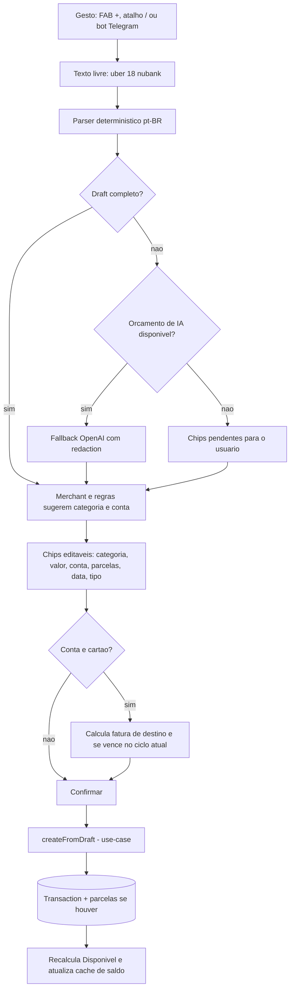
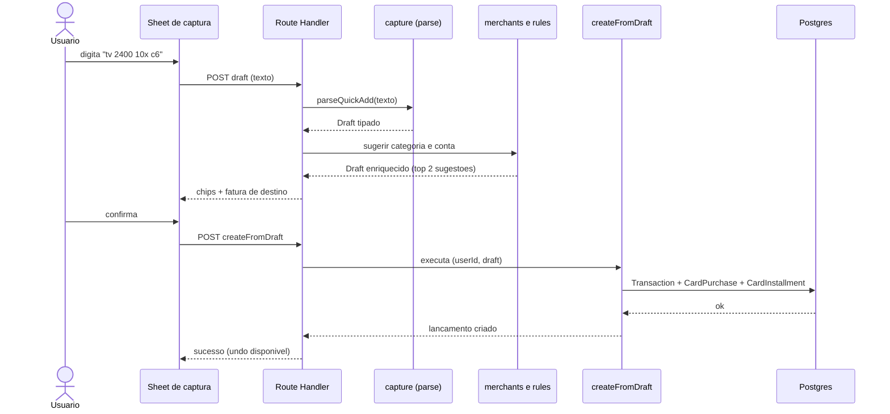

# Fluxo de captura

- **Propósito:** do gesto de captura ao lançamento salvo; inclui parser determinístico, memória de merchant, fallback de IA e destino em fatura de cartão.
- **status:** rascunho
- **Relacionados:** [`../architecture/components.md`](../architecture/components.md), [`../data/modelo-fc2.md`](../data/modelo-fc2.md)

## Fluxo principal

## Sequência

Nota: a mesma função `createFromDraft` atende UI, bot e MCP (ADR-025).

## Estado atual (1.x)

Não há captura global: lançar exige formulário em `/transactions` (2 digitações e 5 a 9 cliques) e a conta default é a primeira em ordem alfabética. A criação passa por `src/app/api/transactions/route.ts` com Prisma direto.
