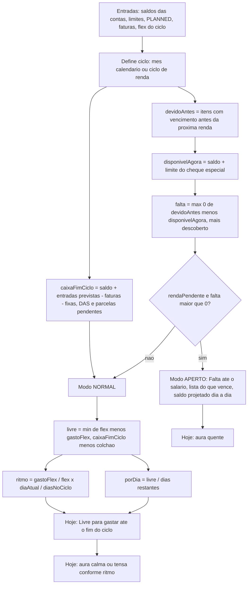
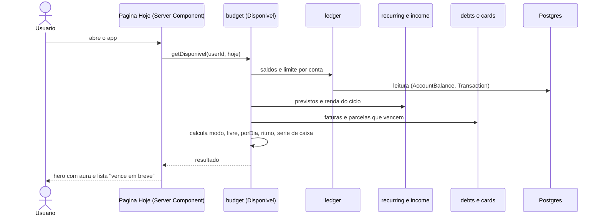

# Fluxo do cálculo "Disponível"

- **Propósito:** como a engine Disponível transforma saldos, previstos e flex em modo, valor livre e R$/dia. Funções puras; fórmulas na especificação §5.1.
- **status:** rascunho
- **Relacionados:** [`../architecture/components.md`](../architecture/components.md)

## Fluxo principal

## Sequência de uma abertura do app

## Estado atual (1.x)

Não existe esta engine. `application/forecast/calculate-forecast.ts` projeta receita menos despesa sem tratar faturas e transferências, e o "resumo do mês" em `application/analytics/monthly-summary.ts` soma só o mês corrente e ignora transferências. O forecast fica fora do layout principal. Documento legado: [`../architecture/flows.md`](../architecture/flows.md).
