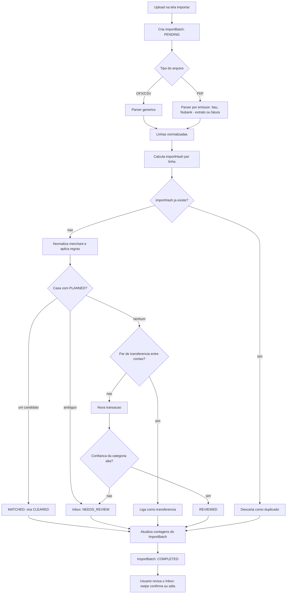
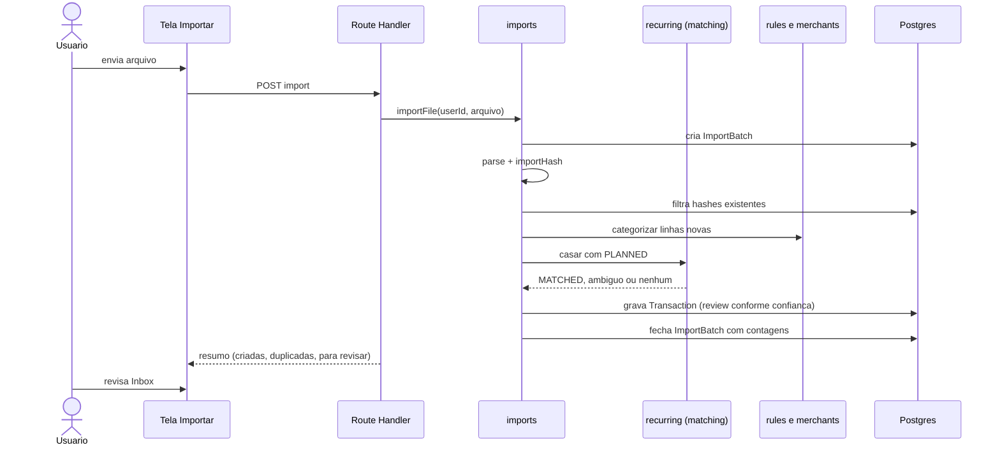

# Fluxo de importação de extratos

- **Propósito:** arquivo PDF/OFX/CSV até lançamentos confirmados, com deduplicação, matching e Inbox.
- **status:** rascunho
- **Privacidade:** arquivos reais ficam em `private/` (gitignored); fixtures de teste são sintéticas em `tests/fixtures/`.
- **Relacionados:** [`../data/modelo-fc2.md`](../data/modelo-fc2.md)

## Fluxo principal

## Sequência

## Estado atual (1.x)

Não existe importação: nenhum parser nem `ImportBatch`. Todos os lançamentos são manuais.
